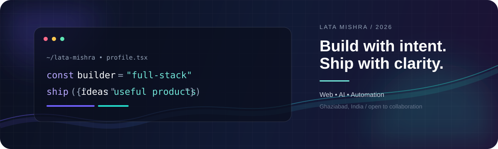
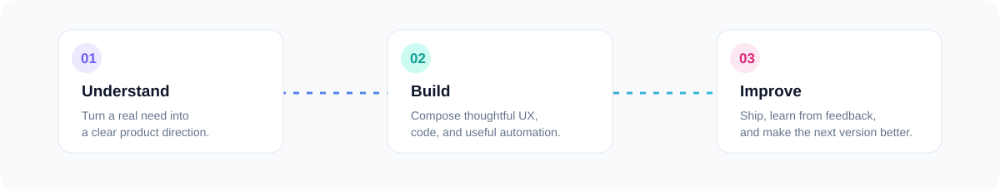
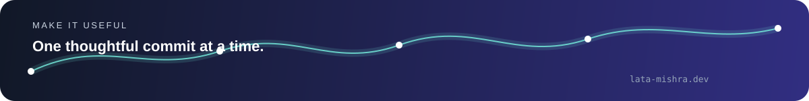

  

   
  <a href="https://latamishra.in">Portfolio</a> ·
  <a href="https://latadigitalsolutions.tech">Digital Solutions</a> ·
  <a href="https://www.linkedin.com/in/latamishra5/">LinkedIn</a> ·
  <a href="mailto:latamishra987@gmail.com">Email</a>
    
  
  

 

<table>
  <tr>
    <td width="55%" valign="top">
      <h2>👋 Hello, I'm Lata Mishra</h2>
      
<strong>Full Stack Developer</strong>

      

        I build responsive, user-focused web applications and digital experiences
        with modern frontend and backend technologies.
      

      

        My portfolio brings together my skills, education, certifications, projects,
        and experience as a Full Stack Developer.
      

    </td>
    <td width="45%" valign="top">
      <h2>⚡ At a glance</h2>
      <table>
        <tr><td>🧩 Builds</td><td>Web apps, dashboards, tools</td></tr>
        <tr><td>🤖 Explores</td><td>AI, automation, computer vision</td></tr>
        <tr><td>🛠️ Ships with</td><td>TypeScript, Python, React</td></tr>
        <tr><td>🎯 Cares about</td><td>Clarity, accessibility, impact</td></tr>
      </table>
    </td>
  </tr>
</table>

## ✦ How I turn ideas into products

  

## ✦ Selected work

<table>
  <tr>
    <td width="50%" valign="top">
      <h3>🧠 <a href="https://github.com/latamishra5/resumeanalyzer_ai">Resume Analyzer AI</a></h3>
      
AI-powered resume screening, ATS scoring, and personalized improvement recommendations.

      Python · Streamlit · Gemini AI
    </td>
    <td width="50%" valign="top">
      <h3>🕸️ <a href="https://github.com/latamishra5/advisor-dashboard">Advisor Dashboard</a></h3>
      
Responsive dashboard with an interactive relationship graph and focused product UI.

      Next.js · TypeScript · Tailwind CSS
    </td>
  </tr>
  <tr>
    <td width="50%" valign="top">
      <h3>🍽️ <a href="https://github.com/latamishra5/foodorderingwebsite">Food Ordering Website</a></h3>
      
Full-stack ordering experience with user and admin functionality.

      EJS · JavaScript · Node.js
    </td>
    <td width="50%" valign="top">
      <h3>🎨 <a href="https://github.com/latamishra5/cartonify">Cartonify</a></h3>
      
Image transformation project exploring practical computer vision.

      Python · Computer Vision
    </td>
  </tr>
</table>

  

## ✦ Toolkit

  

  
<strong>What I can help build</strong>

   

  | Product direction | Engineering | Experience |
  | --- | --- | --- |
  | MVPs and internal tools | Frontend and backend systems | Responsive interfaces |
  | AI-assisted workflows | APIs and database flows | Dashboards and admin panels |
  | Automation ideas | Authentication and integrations | Accessible user journeys |

## ✦ Let's make something useful

<table>
  <tr>
    <td valign="middle">
      <strong>Have an idea, freelance requirement, or collaboration in mind?</strong> 
      Tell me what you are building and where you are stuck.
    </td>
    <td align="right" valign="middle">
      
    </td>
  </tr>
</table>

  

